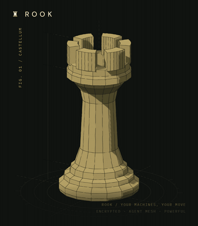
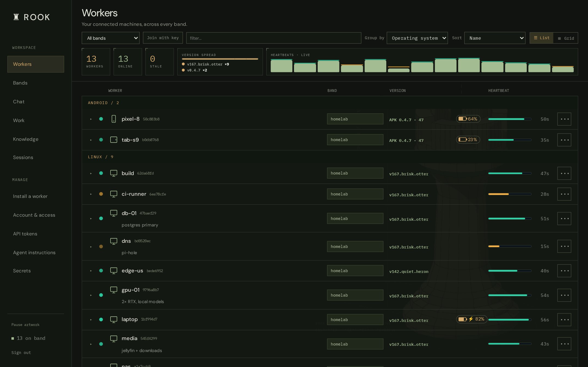

# Rook

**Run things on all your machines from one place: a web dashboard, a terminal UI, or any AI agent that speaks MCP.**

[Website and 48-second tour](https://bake-ware.github.io/rook/)

You install a small background **worker** on each machine you want to reach (a home server, a Raspberry Pi, a laptop, a cloud VM, an Android phone, even a USB dongle). Workers dial *out* to a **hub** you host, so they work behind home routers and on other networks, and join an end-to-end encrypted group called a **band**. From then on you get one live view of every machine and can tell any of them to run a command, take a screenshot, type on the keyboard, restart a service or send a message, and get the answer back straight away.

<p align="center">
  
</p>

- **One control panel** instead of a dozen SSH sessions.
- **Reach machines you normally can't**: they connect out, so you never open ports on them.
- **Let AI agents help**: the MCP server gives Claude Code, Codex or any MCP client the same controls you have, with every call journaled, a shared wiki, a task board, a secret vault and chat rooms.
- **Self-updating fleet**: workers verify and install signed updates by themselves.

> **Status: early, single-maintainer software.** It runs a real fleet, but interfaces
> change and parts are still being hardened (see [Security model](#security-model)).
> Anyone who holds a band's key can run commands on every worker in it; treat that key
> like a root password.

- [Quickstart](#quickstart): a hub, one worker and a first call, on one machine
- [How it works](#how-it-works): architecture
- [Going beyond localhost](#going-beyond-localhost): LAN, remote workers, HTTPS, installers
- [Configuration](#configuration) · [Security model](#security-model) · [Repository layout](#repository-layout)
- **[Feature tour](docs/FEATURES.md)**: capabilities, Android app, USB dongle, PiKVM, dashboard, TUI, agent workspace, OTA

## Quickstart

This stands up a complete hub on your own machine, joins that same machine as a worker,
and runs a command on it. It takes about ten minutes, most of it compiling the relay.

**You need:** Linux (macOS should work but is untested), Python 3.11+, `git`, and a Rust
toolchain (`cargo`, from [rustup.rs](https://rustup.rs)) to build the relay. Windows and
Android work as *workers*; these hub steps assume a POSIX shell.

### 0. Prerequisites

On a fresh Debian 12+ / Ubuntu 24.04+ machine (older Ubuntu ships Python 3.10; install a
newer `python3` first):

```sh
sudo apt-get update
sudo apt-get install -y git python3-venv build-essential pkg-config curl
# Fedora: sudo dnf install -y git python3 gcc make pkgconf-pkg-config curl
# Arch:   sudo pacman -S --needed git python base-devel pkgconf curl

# Rust, for building the relay, then load it into this shell
# (rustup only adds ~/.cargo/bin to PATH for new login shells):
curl --proto '=https' --tlsv1.2 -sSf https://sh.rustup.rs | sh -s -- -y
. "$HOME/.cargo/env"
```

### 1. Install

```sh
# The relay: a small Rust program that forwards encrypted band traffic.
cargo install --locked --git https://github.com/Bake-Ware/telesthete telesthitium
# (installs `telesthete-hub` into ~/.cargo/bin)

# Rook itself: the hub (dashboard + MCP server), worker and CLI.
git clone https://github.com/Bake-Ware/rook
cd rook
python3 -m venv .venv
. .venv/bin/activate
pip install -e .              # add '.[desktop]' for screenshots on desktop workers
```

### 2. Start the hub

```sh
scripts/local-hub.sh                 # this machine only
BIND=0.0.0.0 scripts/local-hub.sh    # reachable from your LAN (see "Workers on your LAN")
```

On first run it generates a band key, a dashboard password and an MCP token into
`rook-data/quickstart.env` (mode 600), then starts the relay and the hub (dashboard and
MCP server in one process, `rook-hub`) in the foreground (Ctrl-C stops both):

```
  Dashboard   http://127.0.0.1:7005    password: …
  MCP         http://127.0.0.1:7005/mcp      bearer token in rook-data/quickstart.env
  Relay       udp://127.0.0.1:7474

Install a worker:  http://127.0.0.1:7005/#install
```

The script finds `telesthete-hub` in `~/.cargo/bin` even if that is not on your PATH yet.
On first start the dashboard also builds the worker bundle its installers download; that
takes about a minute in the background.

### 3. Enroll a worker

In a second terminal (same virtualenv), join this machine to the band:

```sh
rook worker --hub 127.0.0.1:7474 \
  --psk "$(grep ^ROOK_BAND_PSK= rook-data/quickstart.env | cut -d= -f2-)" \
  --name my-worker
```

Workers announce themselves every 30 seconds, so give it up to half a minute to appear.

> If this machine already runs a Rook worker that was enrolled with a hub, saved state
> in `~/.rook-band-worker/` takes precedence over `--hub`/`--psk` (the worker logs a
> warning when it does). Run the demo worker with `HOME=$(mktemp -d)` to keep it separate.

### 4. Make a first call

**In the browser:** open <http://127.0.0.1:7005>, sign in with any username and the
printed password, and `my-worker` is in the Workers list. Expand it to see its
capabilities, and run `shell.exec` with `{"cmd": "uname -a"}` from the form.

**From the command line**, through the dashboard API:

```sh
. rook-data/quickstart.env
curl -s -u "admin:$ROOK_WEB_PASS" -H 'Content-Type: application/json' \
  -d '{"cap": "shell.exec", "target": "my-worker", "args": {"cmd": "uname -a"}}' \
  http://127.0.0.1:7005/api/band/call
# {"id": "…", "from": "…", "ok": true, "result": {"ok": true, "code": 0, "stdout": "Linux …", "stderr": ""}}
```

**From an AI agent**, over MCP. For Claude Code:

```sh
. rook-data/quickstart.env
claude mcp add --transport http rook http://127.0.0.1:7005/mcp \
  --header "Authorization: Bearer $ROOK_MCP_STATIC_TOKEN"
```

Then ask it to "list my Rook workers and run `uptime` on my-worker". It will use
`rook_workers` and `rook_call`. Any MCP client that supports streamable HTTP with a
bearer header works the same way.

In Claude Code you can also install the Rook mod, a pane showing your bands,
sessions across the band and its open tasks (the Deck). See
[integrations/claude-code](integrations/claude-code/README.md).

**In the terminal UI:** run `rook` (or `rook band`). It connects to `http://127.0.0.1:7005`
by default (`--url` for another hub) and prompts for the dashboard password.
Every call it makes goes through the hub, under that login.

### Or run the hub with Docker

```sh
cp .env.example .env
python3 -c "import secrets; print(secrets.token_urlsafe(16))"   # use as ROOK_WEB_PASS
python3 -m rook.remote.psk                                       # use as ROOK_BAND_PSK (needs rook installed)
$EDITOR .env        # set ROOK_WEB_PASS, ROOK_BAND_PSK and ROOK_MCP_STATIC_TOKEN
docker compose up -d --build
```

This publishes the dashboard and MCP server on 7005 (and the MCP server alone on 8765,
where older setups expect it) and the relay on 7474/udp, with state in the `rook-data`
volume. Upgrading from the two-service compose file: `docker compose up -d --build
--remove-orphans`. Join workers exactly as in step 3, using the Docker
host's address. The image builds the relay from source, so the first build takes a few
minutes. (The compose setup has not yet been run in CI; please report problems.)

## How it works

```
   you / agents                         hub (you host it)                         workers
 ┌──────────────┐  HTTPS   ┌──────────────────────────────────┐
 │ browser      ├─────────►│ rook-hub :7005 (one process)     │
 │ rook (TUI)   │          │  dashboard (web UI, installer,   │◄─┐
 └──────────────┘          │    band controller)              │  │ UDP     ┌─────────────────┐
 ┌──────────────┐  MCP     │  MCP server /mcp (tools,         │  ├─────────┤ worker (LAN)    │
 │ Claude Code, ├─────────►│   journal, chat, vault, wiki,    │  │         └─────────────────┘
 │ Codex, …     │          │   /band WebSocket bridge) ◄──────┼──┼── WSS ──┤ worker (remote) │
 └──────────────┘          │                                  │  │         └─────────────────┘
                           │ relay (telesthete-hub) :7474/udp ├──┘
                           │   forwards by band_id, no keys   │
                           └──────────────────────────────────┘
```

| Part | What it is | Runs as |
|---|---|---|
| **Worker** | Pure-Python agent on each machine. Loads plugins that register dot-named **capabilities** (`shell.exec`, `file.read`, `screenshot.capture`, `hid.type`, …); a plugin only loads where it can work. Announces its name, version and capabilities every 30s. | `rook worker`, or the `band-worker.pyz` bundle the installers deploy |
| **Band** | The workers and controllers that share one pre-shared key (PSK). Traffic is encrypted with ChaCha20-Poly1305 using a key derived from the PSK; `band_id = SHA256(PSK)[:16]` is the only cleartext label. | [telesthete](https://github.com/Bake-Ware/telesthete) protocol |
| **Relay** | A blind forwarder: routes packets by `band_id` and never holds a key, so it can't read or forge traffic. | `telesthete-hub` (Rust) |
| **Dashboard** | Web UI, worker installers and pairing codes, band and account management, and the controller that pushes signed updates and deauths. Joins the band as a controller. | `rook-hub` (`rook hub serve`), with the MCP server in one process; or alone as `rook-dashboard` |
| **MCP server** | Exposes the band to agents as MCP tools (`rook_workers`, `rook_call`, consoles, chat, tasks, knowledge, secrets), journals every call under the caller's token, and bridges WebSocket workers onto the relay at `/band`. | `rook-hub`, on the dashboard's port (and alone on :8765, `--mcp-bind`); or alone as `rook-mcp` |
| **Control planes** | The dashboard, the `rook band` terminal UI (talks to the dashboard API) and MCP all see the same roster and call the same capabilities. | |

A call goes: client → dashboard or MCP server → encrypted band message through the relay →
the target worker runs the capability → the reply comes back the same way. LAN workers
talk UDP to the relay directly; remote workers use a WebSocket to the hub's `/band`
bridge, usually through a TLS reverse proxy or tunnel on port 443.

Hub state (band keys, enrollment database, API tokens, call journal, chat, vault,
knowledge) lives in one directory, `ROOK_DATA_DIR`. Back it up and keep it private.
Worker state lives in `~/.rook-band-worker/` on each machine.

The [feature tour](docs/FEATURES.md) covers everything built on this: the full capability
list, the Android app, the ESP32 USB-keyboard dongle, PiKVM and HDMI-CEC, dashboard views,
the agent workspace, OTA updates and the installers.

## Going beyond localhost

**Workers on your LAN.** Start the hub with `BIND=0.0.0.0 scripts/local-hub.sh`, open the
printed `http://<hub-ip>:7005/#install` in a browser, sign in, and click **Get a pairing
code**. The page shows the command for Linux/macOS (`curl … | bash`), Windows PowerShell
(`iex (irm …)`) and Android (Termux) with the code filled in; run it on the new machine
within five minutes (the code renews while the page is open). The installer enrolls with
the code, installs the worker as a service, and the machine appears under Workers.

Everything runs over plain HTTP here: `local-hub.sh` passes `--domain http://<hub-ip>:7005`,
so installer links say `http://`, cookies are not marked `Secure`, and workers accept a
plain-HTTP enrollment server only at a non-public IP address. Installed workers reach the
relay through the hub's WebSocket bridge (`--hub <hub-ip>:7005 --ws`, the same path a
public hub uses behind TLS), so allow TCP 7005 through the hub's firewall (and 8765 for
workers set up by an older `local-hub.sh`, which pointed them there). Workers
you start by hand can instead use UDP directly: `rook worker --hub <hub-ip>:7474 --psk … --name …`
(allow UDP 7474). With Docker, set `ROOK_DOMAIN=http://<hub-ip>:7005` and
`ROOK_HUB_PUBLIC=<hub-ip>:7005`. To reach MCP by IP, add that `host:port` to
`ROOK_ALLOWED_HOSTS` (`local-hub.sh` does; the `ROOK_DOMAIN` host is always allowed). Plain HTTP is for a network you trust: anyone on
it can read pairing codes and installer traffic. Use the HTTPS setup below for anything else.

**Workers anywhere.** Put the hub behind HTTPS: a reverse proxy (Caddy, nginx) or a tunnel
(Cloudflare Tunnel) that forwards your domain to the hub (7005); `rook-hub` serves the MCP
paths there too. (With `rook-dashboard` and `rook-mcp` as two processes, forward the paths
`/mcp`, `/band`, `/tokens/account-api`, `/authorize`, `/token`, `/skill/` and
`/.well-known/` to the MCP server on 8765, as before; `rook-hub` still serves them on 8765
as well, so an existing proxy setup keeps working.)
Then remote workers join with `--hub your.domain:443 --ws`. Set:

- `ROOK_DOMAIN=your.domain` and `ROOK_HUB_PUBLIC=your.domain:443` for the dashboard, which
  writes them into installer scripts;
- `ROOK_MCP_PUBLIC_URL=https://your.domain` and `ROOK_ALLOWED_HOSTS=your.domain` for the MCP
  server (this also enables the OAuth front door that the claude.ai web connector needs).
  `rook-hub` takes both sets of settings (see `rook hub serve --help`); moving an existing
  two-process hub to it is a short runbook in
  [docs/operations/hub-deploy.md](docs/operations/hub-deploy.md#moving-to-one-hub-process).

Never expose the dashboard without `ROOK_WEB_PASS`; it refuses to start on a non-loopback
address without one unless you pass `--insecure-no-auth`.

**One-line installers.** On HTTPS the **Install a worker** page works the same way, and
machines join with `curl -fsSL 'https://your.domain/worker?band=CODE' | bash` (PowerShell
and Android variants are on the same page). A `ROOK_DOMAIN` without a scheme means `https`;
write `http://…` or `https://…` to be explicit. The installers download a worker bundle.
The dashboard builds one itself on first start (into `ROOK_DATA_DIR/worker-bundle`, signed
with the hub's key, using the pip-installed [telesthete](https://github.com/Bake-Ware/telesthete))
and rebuilds it when the installed code changes. To decide yourself when a new build goes
out (connected workers update to it), build it by hand from a source checkout; a bundle
built next to the script takes precedence and is never rebuilt automatically:

```sh
ROOK_PUBLIC_BASE=https://your.domain python rook/remote/build_band_worker.py
```

Workers verify updates and deauth orders against an ed25519 key. The hub creates its own
signing key on first start (in `ROOK_DATA_DIR`, or `ROOK_UPDATE_KEY` to choose the path), and
the build stamps the public half into the bundle, so your workers trust your hub and nobody
else. Workers run from a source checkout or pip install trust no key unless you set
`ROOK_UPDATE_PUBKEY` (printed by `python rook/remote/update_keys.py pubkey`).
See [Installers served by the hub](docs/FEATURES.md#installers-served-by-the-hub) and
[OTA self-update](docs/FEATURES.md#ota-self-update).

## Configuration

Hub, band, worker and plugin settings are on the dashboard's **Settings** page, which
shows each value's source. An environment variable or flag always wins over the page (and
the page says so); the band key is managed on the **Bands** page, and `ROOK_BAND_PSK` only
seeds the first band. Every key, its variables and default are listed in
[`docs/operations/settings-reference.md`](docs/operations/settings-reference.md) (generated
from the schema). [`.env.example`](.env.example) covers a first deployment. The main ones:

| Variable | Used by | Meaning |
|---|---|---|
| `ROOK_DATA_DIR` | dashboard, MCP | Directory for all hub state |
| `ROOK_BAND_PSK` | all | Band key. Generate with `python -m rook.remote.psk` |
| `ROOK_WEB_PASS` | dashboard | Dashboard admin password (required off-loopback) |
| `ROOK_DOMAIN`, `ROOK_HUB_PUBLIC` | dashboard | Public addresses written into installers (`ROOK_DOMAIN` may start with `http://` or `https://`) |
| `ROOK_MCP_STATIC_TOKEN` | MCP | Fixed bearer token for MCP clients |
| `ROOK_MCP_PUBLIC_URL`, `ROOK_ALLOWED_HOSTS` | MCP | Public URL and accepted Host headers |
| `ROOK_HUB` | worker, MCP | Relay `host:port` |
| `ROOK_UPDATE_URL`, `ROOK_UPDATE_PUBKEY` | worker | OTA manifest URL; trusted signing key for workers not installed from a hub bundle |
| `HUB_BIND`, `HUB_PEER_TTL_SECS` | relay | Relay address; keep the TTL at 60 or more |

Google sign-in, the knowledge wiki's embeddings service, voice and the watchdog's Telegram
alerts are optional; see the [feature tour](docs/FEATURES.md) and `services/`.

## Security model

- **The PSK is the credential.** Every peer on a band shares one key, and knowing it lets you
  send commands to every worker. Generate keys with `python -m rook.remote.psk`, keep them out
  of shell history and process arguments (use the environment), and rotate one from the
  dashboard's **Bands** page if it leaks.
- **The relay is blind**: it can drop or delay traffic, but not read or forge it.
- **Updates and deauth are signed** with a separate ed25519 key, so band membership alone can't
  push code to workers, evict them or repoint them at another hub or key.
- **Permissions** (`docs/design/permissions.md`): the hub evaluates a policy per principal, cap
  and worker, and signs a short-lived ticket for each call. It ships in audit mode (would-be
  denials are journaled, nothing is refused) until you set `"mode": "enforce"` in `policy.json`
  or on the dashboard's **/permissions** page. Give tokens the least role they need at mint.
- **The dashboard and MCP server are the admin surface.** Put them behind HTTPS and strong
  passwords, and give each agent its own MCP token so the journal shows who did what.
- **Known gaps:** there is no per-worker identity on the band yet, so a hostile peer that holds
  the PSK can't be cut off without rotating the key; deauth stops only cooperative workers; the
  ESP32 dongle's firmware OTA is not signed. See [Security](docs/FEATURES.md#security).

Please report vulnerabilities privately to the maintainer rather than in a public issue.

## Repository layout

```
rook/
  worker/        the worker: core, transports, plugins, OTA self-update
  remote/        dashboard server: installers, enrollment, accounts, OTA build + push
  band_mcp/      MCP server: band tools, consoles, chat, vault, journal, watchdog
  core/          plugin contract and host shared by hub and workers
  hub/           the hub node (worker `rook`) and hub plugins: knowledge wiki, tasks/projects/concepts, chat rooms
  web/           dashboard front end
  cli/           `rook band` terminal UI and Claude Code history tools
android/         native Android worker app (Kotlin + bundled Python worker)
firmware/        ESP32-S3 USB dongle firmware (PlatformIO)
firmware-rp2040/ RP2040-Zero USB keyboard/mouse dongle firmware (PlatformIO)
server/          standalone MCP server for the dongle's local KVM bridge
pikvm/           systemd unit for running a worker on a PiKVM
services/        optional voice and embeddings services
scripts/         local-hub.sh
docs/            feature tour, design notes, screenshots; docs/spec: the core spec for other implementations
conformance/     test vectors and live harness for the core spec
integrations/claude-code/  Claude Code plugin: the /rook-bands pane (marketplace in .claude-plugin/)
examples/ports/  minimal workers in TypeScript and Rust that pass the conformance suite
tests/           pytest suite
```

## Contributing

See [CONTRIBUTING.md](CONTRIBUTING.md) for the development setup and test suite, and
[CHANGELOG.md](CHANGELOG.md) for what has changed.

## License

Rook is licensed under the [Apache License 2.0](LICENSE). Bundled third-party components keep
their own licenses; see [NOTICE](NOTICE).
