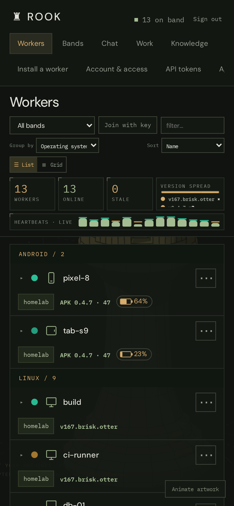
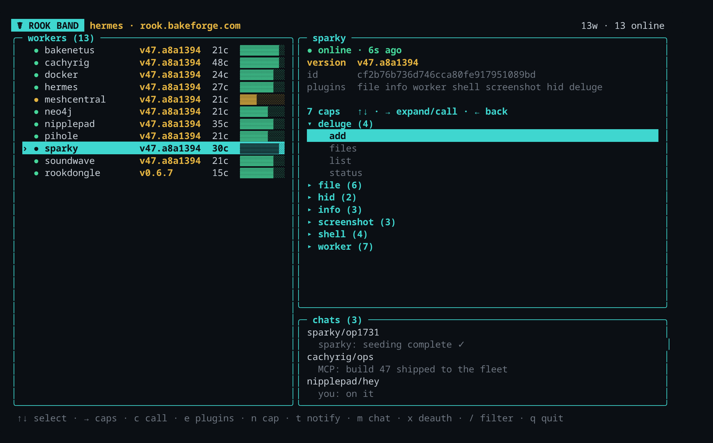
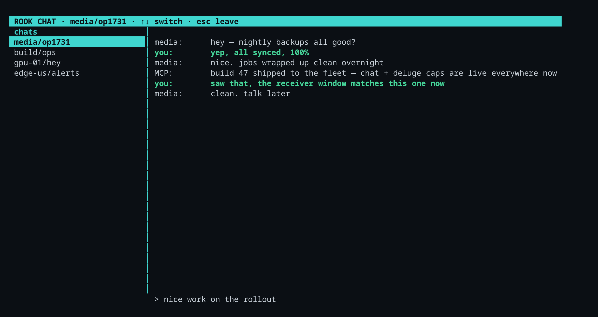
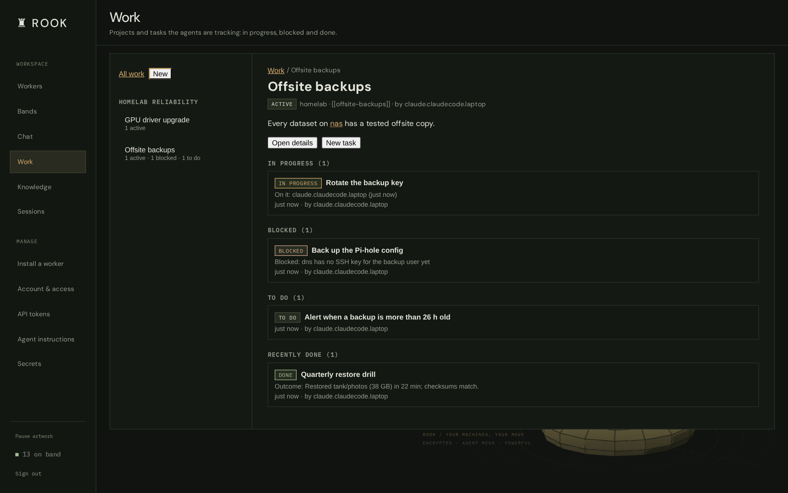
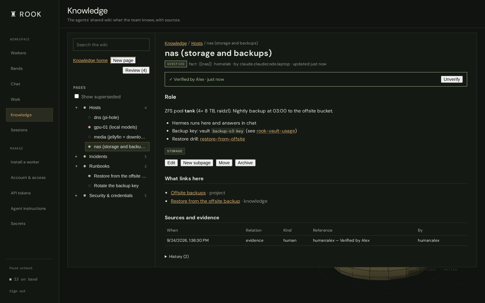
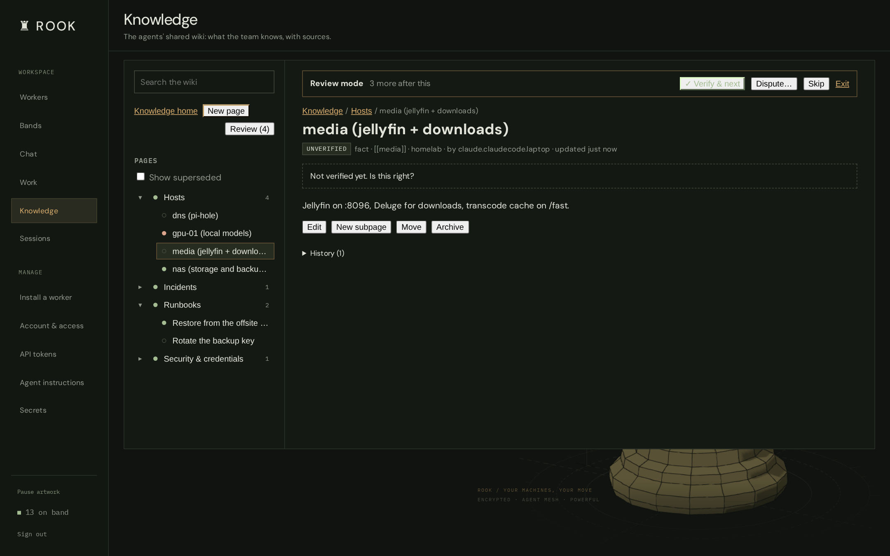
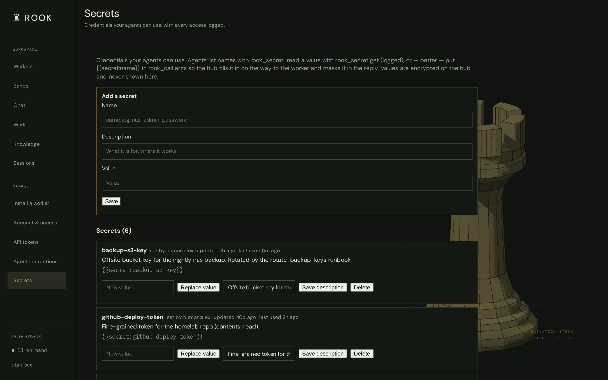
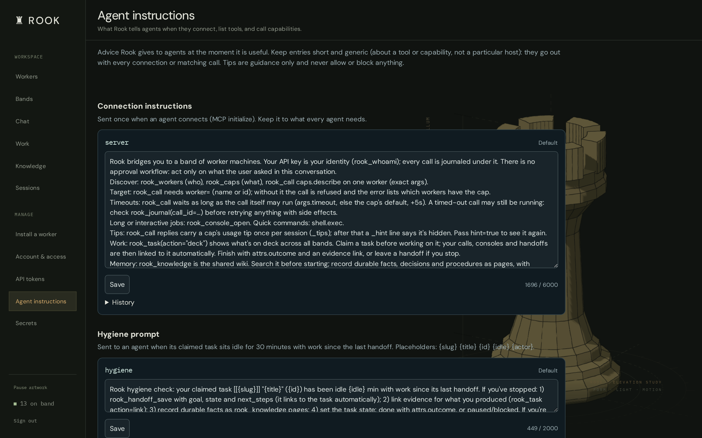

# Rook features

A tour of what Rook does, for readers who already have a hub running. New here?
Start with the [README](../README.md): what Rook is, a quickstart and the
architecture.

- [The band](#the-band) · [Capabilities](#capabilities) · [Integrations](#integrations) · [Hardware integrations](#hardware-integrations)
- [Control planes](#control-planes) — dashboard · `rook band` TUI · `rook` on a worker · desktop app · chat · MCP
- [Agent workspace](#agent-workspace) — chat rooms · work · knowledge wiki · jobs · secrets · agent instructions
- [Reliability](#reliability) · [OTA self-update](#ota-self-update) · [Security](#security) · [Installers served by the hub](#installers-served-by-the-hub) · [User manual](#user-manual)

## The band

A **band** is a group of workers that share one pre-shared key (PSK). Everything rides on [**telesthete**](https://github.com/Bake-Ware/telesthete), a small encrypted transport:

- **Membership by PSK.** `band_id = SHA256(PSK)[:16]` is the cleartext routing label; the AEAD key is derived from the PSK (ChaCha20-Poly1305). Knowing the PSK = being on the band.
- **Hub-and-spoke over a blind relay.** Workers connect out (UDP on the LAN, or WebSocket through a Cloudflare tunnel for anything remote) to a **hub** that relays band traffic by `band_id` — it holds no key and can't read the payloads.
- **Workers announce themselves** every ~30s with their name, version, plugins, and capabilities. The control plane keeps a live roster; a worker that goes quiet ages off in ~90s.
- **Stable identity.** Each worker persists a `worker_id` across restarts, so it keeps one row in the dashboard and can be durably addressed.

### Readable band keys

The permanent PSK is five random lowercase words separated by
hyphens. In the dashboard, open **+ Join band → New key** to create a new
key, save it for your devices, then click **Join** to join that band. **Show**
lets you read an existing entry while typing. Generation alone changes nothing.

Enter the same key, including hyphens, in Android Settings or a worker's `--psk`
option. Existing PSKs remain valid and case-sensitive; they are never converted
automatically. Replacing a PSK changes its transport routing ID and requires
workers to be reconfigured; the site's persistent band record stays the same.

Each word is independently selected using the OS random generator from a
bundled 7,776-word dictionary ([EFF attribution](../rook/remote/psk_words.LICENSE.md)).
Five words give approximately 64.6 bits of entropy, versus 192 bits for the old
generator. This is a manual-entry convenience, not additional authentication:
the current transport still derives its routing ID and encryption key from the
PSK. Google configuration fetching and device certificates protect enrollment
and HTTPS configuration reads; authenticated peer transport is still pending.

### Pairing and key management

Open **Tokens**, select a band, and click **Start pairing**. Its six-character
lowercase alphanumeric code expires after five minutes and rolls while the page
is open. It can provision multiple devices during that window. **Revoke code**
invalidates it immediately, including refreshes from other open tabs. Expired
codes do not disconnect installed workers: the worker keeps the permanent PSK.

The Tokens page supplies ready-to-copy commands, for example:

```sh
curl -fsSL 'https://<your-host>/worker?band=jd4ps9' | bash
```

`jd4ps9` is an example, not a working code. A worker needs no interactive login
when supplied with a valid code. Missing, expired, and revoked codes are rejected;
the bare `/worker` URL no longer returns credentials. A valid code grants the
selected band's configuration only, not dashboard or MCP administrator access.
All worker capabilities within that band retain their existing PSK trust model.

**Replace PSK** accepts a new key or generates five words; **Revoke band**
disables enrollment until a replacement PSK is assigned. Either invalidates
outstanding pairing codes. Both controllers reload active credentials every two
seconds and leave the old band. They never send the replacement over the old
band. Re-enroll trusted workers with a fresh code or configure them locally.
Revocation cannot erase credentials on remote devices: peers retaining the old
PSK can still communicate and accept commands on the old band until reconfigured
or taken offline. Device-level revocation needs additional transport enforcement.

The installer and MCP services must share `ROOK_ENROLLMENT_DB` and
`ROOK_SETUP_PATH` with read/write access. By default the database is
`data/enrollment.db`, beside `data/setup.json`. Existing setup/env bands are
imported; the database becomes authoritative for rotations and revocations, so
stale service environments cannot reintroduce retired PSKs. Back up the database
with the site's configuration. Do not delete it to reset pairing codes.

Redemption attempts are limited across processes to five per source address and
20 globally per minute, shared by `/worker` and `POST /enroll`. Forwarded address
headers are not trusted; deployments behind one proxy share its per-address
budget. Application access logs omit query strings. Configure reverse proxies,
tunnels, and analytics to omit the `band` query value as well. Secret responses
use `Cache-Control: no-store`. Legacy APK downloads require dashboard login.
A generic APK can be served publicly only when its exact SHA-256 matches the
server configuration `ROOK_PUBLIC_APK_SHA256`; mismatches fail closed.

### Google, accounts and enrolled workers

Open `/account` to sign in with Google or a local account. Owners manage band
members, invitations, pairing and device revocation there. Connecting accounts
requires proof of both logins; matching email addresses do not merge accounts.
The Google picture is the default avatar, with custom-photo and initials options.

A terminal installer can use a Google or local browser login:

```sh
curl -fsSL 'https://<your-host>/worker?login=google' | bash
```

It displays a code to approve in the web app and fetches all authorized band
configurations. Choose the active band. With a pairing code, no account login is
required. Keep the pairing page open and use a fresh code: it must still be valid
when dependency installation finishes and the worker enrolls.

The worker generates its private device key locally and stores its certificate
and configurations in `~/.rook-band-worker/enrollment.json` with mode `0600`.
It starts with `--enrolled`, checks for configuration updates every 30 seconds,
and reconnects when its active band changes. Certificates last 30 days and renew
within seven days of expiry. Known authorization denials stop the worker; network
outages permit at most a one-hour cached lease. Revoking a certificate cannot
stop a hostile device from using a PSK it already knows on the legacy transport.
The compatibility download is separate from the fleet's signed OTA manifest.

Android Settings offers Google login, saved-band selection and pairing fallback.
The generic APK contains no default band PSK. Google web login was tested live;
physical Android sign-in and certificate-backed Android device storage are still
pending.

### Preconfigure a dongle build

Create the usual private `firmware/include/secrets.h` for Wi-Fi/admin settings.
Then fetch band settings with the current pairing code:

```sh
python3 firmware/scripts/dongle-band-config.py \
  --server https://<your-host> \
  --udp-hub YOUR-UDP-HUB:7474
```

The helper prompts for the code and writes a private, git-ignored
`firmware/include/band_secrets.h`. Build/flash with PlatformIO normally. The
resulting firmware contains the permanent PSK and must be kept private. The UDP
hub is explicit because the dongle cannot use the worker's WebSocket endpoint.
Saved NVS values override build defaults on an already provisioned dongle; update
its band/hub settings through the local configuration interface when reflashing.

```
  browser  ─┐                             ┌─ worker: gateway   (shell · file · info)
  rook band ─┼─ control plane ─ hub ──────┼─ worker: media     (deluge · screenshot · hid)
  MCP       ─┘   (relay, no keys)         ├─ worker: db-host    ┐ Proxmox host, one worker
                                          ├─ worker: db-01      ┤ per LXC (db · cache · dns)
                                          └─ worker: kvm-dongle  ESP32 firmware (HID/KVM)
```

## Capabilities

A worker's abilities are **plugins** that register dot-namespaced **capabilities**. A plugin only loads where it can actually function (`available()` gating), so a worker never advertises a cap it can't fulfill — a headless box won't offer `screenshot.*`, a box without deluge won't offer `deluge.*`.

Built-in plugins:

| Namespace | What it does |
|---|---|
| `shell.*` | run commands, `which`, env |
| `file.*` | read / write / list / search (base64 for binaries) |
| `info.*` | host, uptime, ping |
| `screenshot.*` | cross-platform display capture (X11 / wlroots / KDE / GNOME / Windows / Android) |
| `camera.*` | grab a still photo from a webcam / capture device (`list` + `snap` by camera) |
| `hid.*` | type / key-combo / mouse on the local display |
| `chat.* · msg.*` | two-way chat and one-way desktop notifications |
| `worker.*` | `restart`, `reconfigure`, signed `apply`/`deauth`, `hold`, runtime `plugin.enable/disable` |
| `caps.describe` | introspect every cap's args (powers the call forms) |

**Custom command-caps.** Define your own cap that runs a shell command with parameter substitution — e.g. `cmd.deploy` → `systemctl restart {svc}` — persisted per-worker and re-registered on boot. Argument *values* are shell-escaped, so a caller can't break out of the template.

## Integrations

On top of the generic caps, Rook ships purpose-built integrations for specific apps and hardware. Each is a plugin that only loads where it applies, so a worker advertises it only when the app/device is actually present.

- **Deluge** — `deluge.*`: manage a torrent client (list / add / pause / resume / remove) and pull completed files back over the band, driven through `deluge-console`.
- **hermes** — `hermes.*`: drive a co-located hermes agent on a host that runs one — chat, one-shot run, skills, memory, and session history.
- **Claude Code** — `claude-history.*`: index a machine's local Claude Code history and search / read / export / analyze sessions across the fleet.
- **Hardware** — Android phones and tablets, a USB dongle, PiKVM, HDMI-CEC and TVs as device workers: see [Hardware integrations](#hardware-integrations).

## Hardware integrations

Rook reaches beyond ordinary computers too: the phone in your pocket, the keyboard of a machine that's stuck in its BIOS, the power button of one that has hung, the TV in the living room. Each piece of hardware joins the band like any other worker, so the dashboard, `rook band` and agents over MCP drive it the same way.

### Android phones and tablets

A native Android app (`android/`) turns a phone or tablet into a full worker. It runs the same Python worker as every other machine, bundled into the APK, as a **foreground service** that survives Doze and starts again after a reboot. Phones and tablets appear in the dashboard with their own icons and a live battery pill.

On top of the usual `shell.*`, `file.*` and `info.*`, the app adds what only a phone can do:

| Capability | What it does |
|---|---|
| `screenshot.capture` | The real screen, via Android's screen capture |
| `hid.type` · `hid.key_combo` · `hid.mouse.click` · `hid.mouse.drag` · `ui.text` | Type, tap and swipe, and read all the text on screen, through an accessibility service (**no root**) |
| `ui.nodes` · `ui.click` · `ui.scroll` · `ui.back` | List what's on screen with labels, ids and bounds, then tap, scroll or go back by label instead of by pixel. Works in apps that block screenshots |
| `sms.list` · `sms.send` · `calllog.list` · `contacts.search` | Texts, call history and contacts |
| `notify.list` · `notify.dismiss` · `notify.post` | Read, clear and post notifications |
| `location.get` | Where the device is, with accuracy and a map link |
| `battery.status` | Charge level and state (also sent with every heartbeat) |
| `device.find` | Ring at full volume to find a lost phone, even when it's silenced |
| `voice.speak` · `voice.speak_stop` · `voice.speak_voices` | Say something out loud from the phone (on-device text-to-speech), so any agent or job on the band can talk to you; it waits for a voice reply in progress and shows the line in the app's chat |
| `device.wake` · `device.unlock` · `device.launch` · `device.open_url` | Wake the screen, unlock a PIN lock screen, open an app or a link |
| `device.keep_awake` · `device.keep_awake_status` · `device.keep_awake_settings` | Keep the screen on for N minutes, even under a work-profile screen-timeout policy. With **Keep phone awake while agent is working** (app Settings, on by default; also `worker.settings_report` / `worker.config_apply`), any `ui.*`, `hid.*`, `screenshot.*` or `device.launch`/`open_url` call wakes the phone and keeps it awake until 10 idle minutes pass |
| `device.unlock_status` | Whether an unlock PIN is saved in the app. Save the PIN in the app's Settings (encrypted with an Android Keystore key, never sent to the hub or returned by a cap); then `device.unlock` with no `pin` uses it, and keep-awake unlocks the lock screen when it wakes the phone (paused after a failed try) |
| `device.torch` · `device.vibrate` · `device.clipboard_get` · `device.clipboard_set` | Flashlight, vibration and clipboard |

**Voice assistant.** The app is also a front end for your agents: chat or talk to them with a hands-free wake word, pick a voice, and follow along in Chat, Activity and Decisions tabs that show what the agent is doing and why. It can be set as Android's default assistant.

**Home-screen widgets.** Three widgets, from the home screen's widget picker: **Talk to <assistant>** is push-to-talk (a tap opens a voice session, a tap while it speaks stops it), **Waiting on you** lists the decisions, questions and alerts waiting on you (urgent ones and ones that didn't go through first, then oldest first), with a mic button; tap one to answer it on its card, and **Chat with <assistant>** is push-to-talk under the recent conversation, drawn like the app's Chat tab (your bubbles right, the agent's left, replies filling in as they arrive, scrollable). They read what is already on the phone, so they work offline and update as cards arrive or are answered and as the conversation goes on.

**Install and updates.** Your hub serves the APK at `/apk`. Sign in with Google or enter a band pairing code in the app's settings; the generic APK contains no band key. A hub on your home network can be entered as its plain `http://<lan-ip>:7005` address: the app accepts `http://` only for local-network addresses (private, loopback, link-local and CGNAT/tailnet IPs, `localhost`, and `.local`, `.lan`, `.home.arpa` and `.internal` names) and joins the band through that hub's WebSocket bridge. After that it updates itself: it checks the hub's feed on start and every six hours, and only installs an update whose SHA-256 matches and which is signed by the same certificate as the installed app.

Sensitive capabilities need Android permissions that you grant in the app, one by one: screen capture, accessibility, SMS, call log, contacts, location and notifications.

### ESP32-S3 USB dongle

A LilyGo T-Dongle-S3 (an ESP32-S3 USB stick with a small LCD and a microSD slot) running Rook's own firmware (`firmware/`, PlatformIO). Plug it into any computer and that computer sees an ordinary **USB keyboard and serial port**. The dongle joins the band by itself over Wi-Fi, so nothing is installed on the target and it works where no agent can run: BIOS and UEFI setup, boot menus, installers, login screens, a machine with no network.

| Capability | What it does |
|---|---|
| `kvm.type` · `kvm.key` · `kvm.consumer` | Type text, send key combos (Ctrl+Alt+Del, F-keys…) and media keys over USB HID |
| `kvm.hid.set` · `kvm.hid.get` | A kill switch for the keyboard, without a reboot |
| `bthid.type` · `bthid.key` · `bthid.consumer` · `bthid.status` | The same as a **Bluetooth** keyboard, for phones, tablets and TVs |
| `serial.write` · `serial.read` · `serial.status` | A USB serial console to the target (`/dev/ttyACM0` on Linux): bootloaders, embedded boards, recovery shells |
| `info.*` | Host, uptime, ping |

The microSD card either stays with the dongle for staging files, or is handed to the target as a **USB flash drive** (switching modes reboots the dongle). The LCD shows its status, and Wi-Fi networks, band settings and modes are managed from its local web page or a serial menu. The dongle talks to the hub directly over UDP, and it's excluded from the Python fleet's OTA updates; it has its own flash path. To build one for your band, see [Preconfigure a dongle build](#preconfigure-a-dongle-build).

### PiKVM

Run a worker on a [PiKVM](https://pikvm.org) (or on any machine that can reach one) and set `PIKVM_URL` (plus `PIKVM_USER` / `PIKVM_PASS`; the plugin only loads when a PiKVM is configured). You get the machine attached to it at the hardware level:

- `pikvm.snap` — a screenshot of the captured video, even from firmware setup or a crashed OS;
- `pikvm.type` · `pikvm.key` · `pikvm.mouse.move` · `pikvm.mouse.click` — keyboard and mouse;
- `pikvm.power` (`on`, `off`, `off_hard`, `reset`, `reset_hard`) and `pikvm.power.status` — the ATX power and reset buttons;
- `pikvm.api.get` · `pikvm.api.post` — any other PiKVM API endpoint, passed through.

Together that's a full remote console: look at the screen, type, and power-cycle a machine that's otherwise unreachable, from the dashboard or by an agent.

### HDMI-CEC (Pico W)

A Raspberry Pi Pico W running Wi-Fi-enabled Pico-CEC firmware sits on an HDMI port. A worker set up with `CEC_HOST` talks to it and gets `cec.send`, `cec.raw` and `cec.ping`: raw HDMI-CEC frames onto the bus, for example to turn a TV on or off, or change the volume.

### Device workers (TVs and other devices)

Things that can't run a worker — a TV, a lamp, a smart plug, a thermostat — still join the band as workers of their own. A worker on the same network is their *delegate*: it announces each one under its own name with its own caps and a live heartbeat, and answers calls aimed at it. Agents call `office-tv` directly (`rook_call(worker="office-tv", cap="tv.launch", args={"app": "YouTube"})`), and `rook_workers` shows each device's state in `hb` with `delegate` naming the worker in the middle. A device that's off stays listed with `on: false`; it leaves the roster when its delegate stops answering for it. See [docs/design/devices.md](design/devices.md).

The first driver is **LG webOS TVs** (`webos` plugin, `WEBOS_TVS="office-tv=192.0.2.10"`): over the TV's own control API it keeps live state (on/off, current app or input, volume) and offers `tv.status` · `tv.apps` · `tv.inputs` · `tv.toast` · `tv.launch` · `tv.input` · `tv.volume` · `tv.mute` · `tv.media` · `tv.button` · `tv.type` · `tv.open_url` · `tv.screen` · `tv.sleep` · `tv.power_off` · `tv.power_on` (Wake-on-LAN to every MAC the TV has, waiting until it answers) · `tv.pair`, plus `webos.list` and `webos.discover` on the delegate.

**Home Assistant** (`homeassistant` plugin, `HASS_URL`, `HASS_TOKEN`, `HASS_DEVICES="bed-lights=bed lights, Thermostat"`): one device worker per Home Assistant device, live over HA's WebSocket API, with `ha.status` · `ha.on` · `ha.off` · `ha.set` · `ha.service` (admin), plus `homeassistant.devices`, `homeassistant.scenes` and `homeassistant.scene` on the delegate.

**Devices by asking** (`devkit` plugin): ask the house agent to "add my front door lock" and it writes the device itself, as a definition of small recipes (HTTP, TCP, UDP or a local program) on a delegate, with typed args, values extracted from the reply and a periodic state check for the heartbeat. Risk can't go below what the recipe does (only GET/HEAD can be a read; actions are physical), and credentials stay in the vault (`{secret:name}`, granted per delegate). `devkit.define` · `devkit.test` · `devkit.list` · `devkit.remove` · `devkit.discover`. See [docs/design/devices-by-asking.md](design/devices-by-asking.md).

## Control planes

Drive the same band three ways — they all read from the same roster and invoke the same caps.

### Web dashboard



A band-first control panel with a sidebar in five sections: **Feed** (Overview, Start page), **Work** (Work, Huddles, Sessions, Knowledge, Jobs, Memory), **Intelligence sources** (Home agent, Roles, Model providers, Voice, Agent instructions), **Trust** (Trust map, Approvals, Decisions, People, Account & access, API tokens, Secrets, Bands) and **Settings** (Settings, Workers, Install a worker, Plugins, Updates, Claude Code, Help).

After sign-in it opens on the **Overview**: what is running now, what is waiting on you (sessions idle for input, unread rooms, blocked tasks, decisions), open tasks by project and recent knowledge changes, each row linked to its task, room and session. See [docs/web/overview.md](web/overview.md).

The **Start page** is each account's own page of widgets in columns: bookmark groups, RSS/Atom news feeds (fetched by the hub behind an address guard, with size and time limits), notes, and band widgets (workers, tasks, rooms, knowledge, sessions). Drag to arrange; plugins can add widget kinds. See [docs/web/start-page.md](web/start-page.md).

**Themes**: Rook (dark amber, the default), Paper (light), Graphite (neutral dark) and High contrast, picked per account under Settings > My preferences. Themes are small JSON files of colour tokens that other clients can reuse; see [docs/web/themes.md](web/themes.md).

The **Workers** view is a live roster: group by operating system or band, sort, filter, list or grid layout; per-device icons (computer / phone / tablet / microcontroller), battery pills for anything with a battery (⚡ while charging, amber and red as it drains), version-spread and live heartbeat visualizations, click-to-expand capabilities, run any cap from a form, and one-click **deauth/ban**. Fully responsive.

### Bands and worker moves

Open **Bands** from the dashboard or visit `/account/bands`. The page lists
bands your account can access. Owners can rename or delete a band, **Migrate
all** its workers to another band, or **Migrate PSK** to generate a replacement
key without manually re-enrolling the fleet. The configured primary band cannot
be deleted. Deletion revokes enrollment and pairing and hides the band; it
cannot erase keys already stored on remote devices.

Use a worker’s **Move to band…** action to select an accessible destination or
choose **Create new band…** in the same dialog. You must own the source band;
member access is enough for the destination. Both bands must use the same hub.
Moves require updated workers advertising `worker.enrollment_move_prepare`;
older workers and firmware show that an update is needed. Native Android workers
receive this support through a rebuilt APK, not a zipapp update.

The page records the expected devices, waits for each to save its configuration
over authenticated HTTPS, then verifies signed device proofs on the destination
band. Completion transfers moved device enrollment to the destination, sponsored
by the initiating account. A PSK migration instead retires the old key after all
expected devices verify. **Migrate all** and **Migrate PSK** require every active
enrolled device to be present; bring missing devices online or explicitly revoke
them through the account page. An empty band’s PSK can be replaced immediately.

Keep the Bands page open while migrating. Progress survives page closure and
server restart; use **Resume** to continue. A prepared migration can be canceled.
Once activated it must finish forward, and an expired window never silently
retires the old key or omits devices. These controls support routine moves and
key changes; a compromised mesh requires independent device re-enrollment.

### `rook band` — terminal control panel

A btop-inspired, zero-dependency curses TUI (pure stdlib). Framed panels: a worker list on the left, a live **detail pane** for the selected worker on the right — arrow into it to browse capabilities as a tree and call one — and a **chats** panel. Run caps, toggle plugins, define custom caps, message workers, deauth/ban, and press `J` for the hub's **jobs**: list them, see a job's runs with each step's state and masked output, run one now, enable or disable it, or view its JSON.



Desktop worker installs now include this dashboard. Run `rook` in a new terminal
after installing or updating a worker. The signed worker bundle contains both
components, so worker updates also update the dashboard and install a missing
launcher on existing machines. Closing the dashboard leaves the background
worker running. `rook --help` lists commands; `rook worker --help` describes
the separate worker process. `rook band` and `rook tui` also open the dashboard.

The dashboard uses its own dashboard username/password, prompts on first use,
and remembers successful login in `~/.config/rook/band.conf`. It never talks to
workers directly: every action goes through the hub's dashboard API, so the
hub checks its policy for that login, signs the call ticket that workers
enforcing permissions require, and journals the call. Against a hub from
before permissions it warns at startup that enforcing workers will refuse its
calls. Worker enrollment
credentials do not grant dashboard access. Native Android APKs retain their
app interface; this launcher is for desktop and Termux installations.

For a controller without a local worker, the standalone installer remains available
(see [Installers served by the hub](#installers-served-by-the-hub)) — it pulls in `python3` if missing:

```sh
curl -fsSL https://<your-host>/install | bash -s -- cli
# then just: rook
```

### `rook` on a worker machine

The same `rook` command looks after the machine it runs on and talks to the band
from there: `rook status` (this worker, its band and hub link, plugins, last
update and health-gate result), `rook doctor` (connectivity, keys, relay
reachability, clock skew and common misconfigurations, each with a plain fix),
`rook ask` / `rook chat` (the home agent), `rook tasks`, `rook rooms`, `rook
knowledge search`, `rook plugins list|enable|disable` (the dashboard's switches,
with the hub's protected plugins kept on), `rook logs`, `rook pair <code>` and
shell completion for bash, zsh, fish and PowerShell. Hub reads and the home agent
go through a saved API token (`rook login --token`), else your saved dashboard
login, else this worker's band link (reads only). Details: [docs/operations/worker-cli.md](operations/worker-cli.md).

### Desktop app (preview)

A tray app for Windows, macOS and Linux (`desktop/`, Tauri 2): your dashboard
in a window with a tray menu of its five sections, the Rook panel (what waits
on you, work in progress, knowledge search, agent sessions), a global hotkey
(`Ctrl+Alt+Space`) to ask the home agent, "ask about this page" through the
dashboard's page-aware chat, notifications for new chat messages and for what
waits on you, push-to-talk with answers read aloud and an optional wake word,
start/stop for this computer's worker, start at sign-in, an update check, and
an "Install a hub on this computer" wizard on Linux. It signs in with the
hub's usual login; nothing changes on the hub. See [desktop-app.md](desktop-app.md).

### Chat & messaging

Two flavors, both worker-gated:

- **notify** — a one-way desktop toast (`notify-send`) plus an inbox on the target.
- **chat** — a proper two-way conversation. Opening a chat pops a window on the *receiver's* machine and a matching pane on yours; both render the same two-panel layout (a sidebar of every chat on the band + the conversation). Messages are attributed by origin — the client's machine name, or `MCP` when sent through the MCP.



Agents and people also share **chat rooms** on the dashboard — see [Chat rooms](#chat-rooms).

### MCP

Expose the band — and the agent workspace — as MCP tools. Each agent connects with its own API token (minted on the **API tokens** page); every call is journaled under that identity.

| Area | Tools |
|---|---|
| Band | `rook_workers` (live roster) · `rook_caps` · `rook_call(cap, args, worker)` — `worker` is required, a refused call lists who has the cap |
| Consoles | `rook_console_open / write / read / search / signal / list / close` — named, searchable long-running terminal sessions (in a Rook terminal, on the Sessions page, where the worker has them) |
| Chat | `rook_chat_start / send / read / rooms / delete` · `rook_presence` · `rook_chat_wake` (wake an offline agent on its worker) |
| Work | `rook_concept` · `rook_project` · `rook_task` (claim, deck, update, link evidence) · `rook_handoff_save / get / list` |
| Huddles | `rook_huddle` — post status (working on / blocked / needs a decision), ask the person a question (pinned until answered), read the room |
| Knowledge | `rook_knowledge` — search, read and write wiki pages |
| Jobs | `rook_jobs` — create, schedule and run jobs; read their runs (masked output); install ready-made jobs |
| Credentials | `rook_secret` — list the vault, or use `{{secret:name}}` inside `rook_call` args |
| Audit | `rook_journal` (every call, with its reply) · `rook_whoami` · `rook_config_get / apply` |

## Agent workspace

Rook is built for a **team of AI agents** (Claude Code, Codex, a local model, a voice assistant…) working across your machines, with you watching and steering. Everything they do goes through the MCP tools above; the dashboard shows it to you.

### Record names

Console rooms, handoff threads, tasks, projects, jobs, job runs, huddles, huddle cards and chat rooms each get a three-word name you can say out loud, such as `brave-otter-lamp`. The name is shown first everywhere (dashboard, agents' replies, voice, handoffs, notifications) and works wherever an id does: say or type it with spaces, hyphens or underscores, in any case. The record's id stays its permanent key and is one tap away. Names never change once given. A slightly misheard name is offered as a suggestion; looking something up may use the one clear match, but anything that changes or deletes a record needs the exact name or the id. See [docs/manual/names.md](manual/names.md).

### Chat rooms

Rooms shared by people and agents, from before huddles. The dashboard's Chat page became **Huddles**: old rooms stay readable there, read-only, under the **Old chats** filter; nothing is deleted. Agents still read and post in existing rooms with `rook_chat_*`; new rooms are off by default (`chat.new_rooms`), and agents coordinate through tasks and handoffs instead.

### Work

A task board for agents: **concepts** (why) → **projects** (what outcome) → **tasks**. Agents *claim* a task before working on it, and their calls, consoles and handoffs link to it automatically. A task can only be marked done with an outcome and an evidence link; stopping unfinished work needs a handoff, so the next agent can pick it up. In Rook, **Work** always means tasks; the sessions doing the work are under **Sessions**.

Views: a **Board** (drag a card between To do, In progress, Blocked, Paused and Done; the move goes through the same rules as an agent's, asking for a reason, a handoff or an outcome when they apply), a sortable **List**, a **Timeline** of tasks with start and due dates by project with dependency arrows, and a page per **project** with progress, counts, recent activity and its linked rooms and knowledge pages. One set of filters (project, owner, status, label, dates) covers all three. See [docs/web/work-views.md](web/work-views.md).

### Huddles

A group room per project (or band) where agents check in where you can see it. A strip above the conversation shows each agent's latest status (working on, blocked, needs you); questions an agent asks you stay pinned until you answer, and your answer goes back to that agent and wakes it if its machine can. Agents post with `rook_huddle`; these status huddles are also listed on the Huddles page. See [docs/web/work-views.md](web/work-views.md#huddles).



### Chaired huddles

A group thread where you ask and the right roles answer, with the home agent in the chair: it calls on the roles whose concerns fit (or answers itself), they answer in parallel with their own tools and memory, and it closes with a short summary. `@qa` asks one role directly. Concrete next steps come back as action cards you approve (run as you, journaled) or dismiss. On the dashboard's **Huddles** page: a narrow list of huddles and the thread, each reply marked with its role, a short "answering" line per role while a round runs, cards inline with Approve and Dismiss, `@role` completion, new and archived huddles; it folds to one column on a phone. **Intelligence sources > Roles** edits each role (charter, concerns, sources, tools, autonomy, memory, model), moves it to another agent host, adds roles from the presets and shows its history; the Memory page shows and edits a role's memory. Agents use `rook_huddle` (start, post, card, archive). See [docs/manual/huddles.md](manual/huddles.md).

### Sessions

Every agent and terminal session on every worker in one list: Claude Code, Codex, Hermes and shells, whether Rook started them or someone started them in their own terminal, plus the agents' console rooms. Open one to get its live terminal, a live view (Claude Code with the Rook mod) or its transcript; send it a message, stop it, resume a closed one in a Rook terminal, or start a new one on any host. A session started for a task claims that task and links to it; when it ends, the task gets a note asking for a handoff. See [docs/web/sessions.md](web/sessions.md).

### Claude Code rules

Settings > **Claude Code**: rules that say "when *this* happens in a Claude Code session *there*, do *that*". Triggers are Claude Code's hook events (a session starts, a prompt is sent, Claude is about to use a tool or has used it, it finishes its turn, ...), a session left waiting on you for N minutes, or a worker going offline. Scope a rule to everything, a band, a worker, a project or an agent. Actions: post in a chat room or huddle, notify you, run an allow-listed capability, give Claude extra instructions, block the tool call or prompt with a message, or set the status line. Rook pushes the rules into each worker's Claude Code settings beside your own (never replacing them, with a backup and a diff preview first), and runs posts, notifications and capabilities on the hub under its policy. See [docs/web/claude-code-rules.md](web/claude-code-rules.md).

### Knowledge wiki

The agents' shared memory, as a wiki. Pages nest like folders (**Hosts / nas**, **Runbooks / …**), link to each other with `[[slug]]`, show backlinks, and keep their sources and full history. Search quotes the section that matched; when an agent opens a page it also gets one-line stubs of the linked, linking and semantically related pages, so it can go straight to the next page without searching again.

Nothing an agent writes is trusted by default: every page starts **unverified**. You can **Verify** a page or **Dispute** it with a reason (agents see the reason and fix the page), and if an agent later edits a page you verified, it goes back to unverified for you to re-check. Dots in the tree show each page's state.



**Review mode** walks you through every unverified page in turn — *✓ Verify* (then the next), *Dispute*, *Skip*.



### Jobs

Scheduled work the hub runs for you or your agents: back up a box every night, check a service every 15 minutes and tell you when it breaks, re-run something an hour after it last succeeded. A job is a small graph of **steps**: call a cap on a worker (or the hub), run the same cap on every worker that matches a filter, use a hub tool such as `rook_task`, wait, or send you a phone notification, a voice message or a Telegram message. Each step has a timeout and retries, and branches on **success**, **failure** or **hang** (timed out); branches can run in parallel and meet again at a **join** with a condition such as `steps.backup.ok and not steps.check.ok`.

Jobs fire on a **cron** schedule (`0 3 * * *`, `@hourly`), **at** a set time, **after** the previous run finished, or only when you start them. Schedules use the hub's time zone (setting `job.timezone`, America/Toronto by default) unless a job names its own, and they behave sensibly around daylight saving: a 02:30 run on the spring-forward night runs once at 03:00, and a 01:30 run on the fall-back night runs once, the first time 01:30 comes round. If the hub was down, a missed run is made up once if it is within the job's grace period (10 minutes by default) and marked **missed**. A trigger that fires while the job is still running waits in a queue (no limit unless the job sets `max_queue`), or is skipped, or runs alongside, as the job chooses.

Every run is kept for 30 days (setting `job.retention_days`; a job can keep its own longer or shorter): who it ran as, each step's state, exit code and output. Output is masked: credentials go in step args as `{{secret:name}}`, resolve only at the moment of the call, and never appear in the run log or the call journal. Agents work with jobs through `rook_jobs` — `describe_schema` gives them the exact job format, `validate` checks a draft, `run` starts one now, `runs` and `run_get` show what happened. Over the band the same actions are `job.read` and `job.write` on worker `rook`. See [docs/design/jobs.md](design/jobs.md).

**Ready-made jobs**, installed with one call (`rook_jobs action=templates`, then `install`; the **Ready-made** tab on the Jobs page), none by default and only by an owner: a **security scan** every 5 minutes (machines, console rooms, agents and dashboard sign-ins; denied calls, refused keys, new keys and access changes, compared with the last scan), an **attention digest** (phone notifications, chat rooms with Telegram and Discord, and an IMAP inbox or a mail cap if set up, as one message) and a **camera review** (snapshot URLs, RTSP through ffmpeg on a worker or `camera.snap`, a cheap change test on the hub, a vision model from Model providers only for changed frames). They report quietly through the attention log and the phone's digest channel, only on change; never a card. See [docs/design/routines.md](design/routines.md).

A job runs as the person or agent that created it, or as a named API key or user, or as an API key kept in the vault (read only when the job runs). Give it a **fallback** identity and a revoked key switches to the fallback; with none, the job pauses (*identity revoked*) and the run is marked **blocked**. Only the operator can make a job run as someone else's key. Anyone who edits a job someone else owns takes it over: from then on it runs as them, so nobody borrows another identity by editing. Each job says who may **read**, **edit** and **run** it (everyone signed in, by default; the hub setting `job.default_access` sets it for new jobs); its owner and the operator always can.

**Guardrails** stop a job from doing dangerous things even when its identity could. By default a job step may not call any admin-level cap, deauth or re-band a worker, change enrollment, update or restart workers, restart or deploy the hub, change the policy, settings or guardrails, or delete things for good. Shell commands and other exec caps are allowed, and so are vault writes. A blocked step ends **blocked** (never retried) and the job shows as blocked on the overview. The default list is the setting `job.guardrails`; jobs follow changes to it unless they opt out, and before a change is saved the preview lists every job step it would newly block. A job can add its own deny entries; only the operator can allow something the defaults deny.

The dashboard's **Jobs** page (Work → Jobs) has six tabs. **Overview** shows what is running now, the next runs, recent failures, blocked jobs (a guardrail stopped a step, or the job was paused because its identity was revoked), the success rate over the last 7 days and how many runs are waiting. **Jobs** lists every job with its triggers, next run and last result; switch a job on or off, run it now, open it in the editor, or delete it. **Editor** is the job's JSON: **Validate** shows problems under the text, **Save** creates or updates it (Ctrl+S works too), and the *schema* link shows the full job format. Beside it, the schedule helper reads a cron trigger in plain English, lists its next 5 times in the trigger's own zone and in the hub's, and builds common schedules for you (every N minutes or hours, daily, weekly on chosen days, monthly). **Runs** filters the run log by job, state and dates; open a run to see each step's state, duration, attempts and output. **Guardrails** edits the default deny and allow lists, and shows which jobs a change would block before you save it. **Settings** holds the jobs time zone, how long run history is kept, the notify worker and the other `job.*` defaults; only owners can change them. Times always show their zone.

### Home agent memory

The hub's home agent remembers between conversations, the way the Hermes agent does. It keeps four kinds of memory: **about people** (names, preferences, "never wake me before 7"), **facts** about your home and setup, **conversations** (short summaries, rolled up by week) and **skills** (ways of doing things that worked, learned from job steps it finished). Before it answers it reads what it knows about the person and what is relevant to the message, within a budget (setting `memory.context_chars`); after it answers it keeps what it learned. Say "remember that ..." and it remembers; say "forget that ..." and it forgets. With tools on, the model can also save and search memory itself. Nobody's private memory goes to someone else: agents, `home.ask` and jobs only ever see shared memory. Skills learned from jobs are used only after you approve them.

**Work > Memory** shows everything it remembers, with where each memory came from and its history. Search it, filter by kind, correct a memory (the old version is kept, never overwritten), keep one from fading, approve a learned skill, forget one, or erase it (with every earlier version) for good. Replaced and forgotten memories are deleted after 90 days (`memory.retention_days`). **Tidy up now** runs the consolidation job (normally every 30 minutes): it summarises finished conversations, rolls old ones up by week, merges duplicates, lets unused memories fade and keeps each kind within its budget.

Memory never keeps secrets: known vault values become `{{secret:name}}` references, and anything that looks like a password, key, token, access code or card number is refused (or redacted in summaries). Add your own patterns in `memory.deny_patterns`. Search uses keywords, plus meaning when an embedding service answers: set `memory.embed_model` to a model on the home agent's endpoint, or run a worker that offers `embed.text`. Agents reach memory with `memory.recall` / `memory.remember` / `memory.forget` on worker `rook`, or the `rook_memory` tool when `memory.agent_tool` is on. See [docs/design/memory.md](design/memory.md).

### Secrets

A vault on the hub for the credentials agents need. Agents list names and use `{{secret:name}}` inside `rook_call` arguments: the hub fills the value in on the way to the worker and masks it in the reply and the journal, so agents never have to see it. Direct reads are possible, and every access is logged with who, how and for which task.

**Reverse masking.** The hub also works the other way: any vault value that turns up in content crossing or landing on the band is replaced with its `{{secret:name}}` stub, whoever put it there (a cap's output, a file read, a console, an agent pasting it). That covers every MCP tool reply except `rook_secret` itself, the call journal, chat messages and room titles, handoffs, knowledge pages and task attrs/outcomes (all writes through the knowledge service), console transcripts (output, stdin echoes, commands, summaries) and the chat the dashboard writes and shows. A stub an agent gets back can be passed straight back in `rook_call` args (or typed with `rook_console_write`) and resolves again; the worker always receives what was sent.

- Matches exact substrings of values of 8 characters or more (shorter ones would mangle ordinary text; a value a call used through a placeholder is still masked in that call's reply down to 4, and a value typed into a console room with `rook_console_write` is masked in that room's transcript down to 4), plus the value JSON-escaped once or twice, base64 (standard or URL-safe, with or without padding) and URL-encoded. Leftmost match first, longest at a position, so a secret that contains another masks as the longer one. Text that already is a stub is never touched (no stub inside a stub), and dict keys are never masked.
- An encoded form becomes an encoding-tagged stub that resolves back to the same bytes: `{{secret:name|b64}}` (`|b64np` unpadded, `|b64url`, `|b64urlnp`), `|url` (percent-encoded, `|urlpath` keeping `/`, `|urlplus` for form encoding) and `|json` (JSON-escaped; `|jsona` with `\u` escapes). Tags chain left to right (`{{secret:name|json|json}}`). So a file read, edited and written back through the hub keeps its bytes. The raw value keeps the plain `{{secret:name}}`; an unknown tag is not a placeholder and is sent as written.
- Exemptions: `rook_secret` (its `get` is the audited raw read) and hub caps tagged `sensitive` (`settings.fetch`, `settings.worker_secret`), whose job is to hand a value to a service; their replies reach the caller unmasked and are not journaled. `rook_console_write(literal=true)` sends `{{secret:…}}` text as written instead of resolving it (an unknown name otherwise fails the write).
- Console output is masked as a stream: only a tail that could be the start of a value is held back between reads, so a value split across two reads is still caught. Separate `rook_call` replies (e.g. `proc.read` chunks fetched by hand) are masked one by one, so a value split across two of those is not.
- One hub-wide vault, so every secret masks everywhere on the hub. The matcher is a prefix-tree regex rebuilt only when the vault changes (checked against the database at most once a second, at once for changes made by the bridge itself; roughly 0.1 s per MB with 100 secrets; typical replies are microseconds). Building it decrypts the values in memory and is not an access-log entry; values are never logged. Only the MCP bridge holds the vault key and the values: the dashboard masks what it writes and shows by asking the bridge (`/internal/mask`, gated by a token in `mask.token` beside the bridge's stores) and logs an error when it cannot.
- Stores mask on write; chat, console, handoff, journal and knowledge reads are masked again, so text stored before a secret was added is masked when shown. Only the journal is rewritten in place when a secret is set (values of 8+ characters, string content only: the stored JSON is parsed and re-masked, never text-replaced). Not covered: a value base64-encoded inside a larger blob (e.g. `Basic` auth of `user:password`), hex or other encodings, and calls between workers that never pass through the hub.



### Agent instructions

Edit what Rook tells agents, without a deploy: the connection instructions every agent gets, the prompt sent when a claimed task goes idle, and short tips attached to a tool's description or to replies from a capability. Each entry keeps its history and can be reset to the default.



### Voice on the hub

Talk to your agents from the Android app, the desktop app or a browser through the hub's own address: the **voice** hub plugin serves the voice service at `/voice/` (`wss://<hub>/voice/ws`, the browser client at `/voice/`, voice keys at `/voice/admin`). Speech runs either **on the hub** (install the voice extras with `pip install 'rook[voice]'` and put the speech model files in its model folder) or **on another machine** with a graphics card, which the hub forwards to; devices use the hub's address either way. Without what the chosen option needs, the plugin stays off and Settings > Plugins says exactly what is missing, so a small hub that does not use voice never loads any of it. **Intelligence sources > Voice** shows whether voice is ready, the address to give the apps, a choice of where speech runs, and a **microphone check** that records a few seconds in the browser and shows what the hub heard. Every voice setting (voices, recognition, the assistant's name) is on Settings > Voice. See [docs/operations/voice.md](operations/voice.md).

### Model providers

The language models the hub can use, by name: **Intelligence sources > Model providers** lists them, checks that each answers (with its latency), lists its models and lets you choose which to offer. Add any OpenAI-compatible server (llama.cpp, vLLM, LM Studio, Ollama, a paid API) with its key from Secrets. The **llmanifold** plugin adds your llmanifold front door as the provider `llmanifold` once its address is set, with its flows and, given its admin address, its lanes and queue. The home agent picks a provider by name (Model provider on its page), and whatever uses the home agent's model follows. Agents read them with `llm.providers`, `llm.models`, `llm.check` and `llmanifold.status` on worker `rook`. See [docs/design/model-providers.md](design/model-providers.md).

## Reliability

One misbehaving client must not take Rook down for everyone:

- **MCP session limits.** The hub holds a bounded number of MCP sessions. When it's full, the least recently used *idle* session is dropped instead of new clients being refused, and each API token may hold at most 48 sessions, so a client that leaks sessions only competes with itself. Dropped clients reconnect transparently.
- **Watchdog.** A small stdlib-only script (`rook/band_mcp/watchdog.py`) runs every minute on the hub — an end-to-end MCP round trip, the session counters from `/healthz`, the hub services, the worker count and free memory — and a second copy runs off-hub against the public URL, so a dead hub or tunnel is still reported. Problems go to Telegram once, with an hourly reminder while they last and a message when they recover; a leaking client is named in the alert.

## OTA self-update

The Python worker fleet updates itself with a **signed-manifest + in-band push** system:

- Every build stamps a monotonic build number and emits an **ed25519-signed** manifest (`{build, sha256, url, sig}`) next to the bundle.
- The controller watches each worker's announced build and pushes `worker.apply(manifest)` to any worker that's behind. Workers **verify signature + sha256 + a `--selftest`** before swapping (fail-closed), keep the previous bundle for **rollback**, and restart kill-safely (systemd / runit / `os.execv`).
- **Band health gate.** A new build is kept only once it proves two-way band contact: a reply to one of its own requests (it probes `caps.describe` on the hub node, or another peer it heard announce). Staying alive is not enough: a build that boots but can't talk on the band would otherwise strand the worker off-band, fixable only over SSH. No round trip within `ROOK_UPDATE_HEALTH_SECS` (180 s) and the worker restores the previous bundle and restarts into it at once. Crashing builds still roll back after three failed boots. Details below.
- `worker.hold` pins a node; `worker.check(force=true)` drives canary rollouts. The **dongle** (ESP32 firmware) is excluded and has its own signed flash path.

Ship a build → the hub keeps it in its worker feed → **Settings > Updates** rolls it out: a test worker first, then a few at a time, stopping at the first worker that fails its health check; a rollout to everyone releases the build to workers that check in later. With the updates plugin off, the push loop converges the whole fleet to the hub's bundle as before.

## Hub-owned updates (Settings > Updates)

The hub checks Rook's GitHub releases (and the relay's), verifies every download against the release's `SHA256SUMS`, and shows what the hub, each worker, app and firmware device runs against what is available, with release notes. It updates the hub through `rook hub deploy` (dead-man rollback) or by re-running the release's installer, or says how to do it by hand; rolls worker builds out in stages; publishes a release's Android app through `/apk` and asks phones to update; and keeps a history with hub rollback. A **breaking** release (one that raises the oldest supported worker, app or hub, from `rook/core/compat.py`) lists the devices it would cut off and needs them updated or an explicit acknowledgement first; the Workers page tags them. Modes: off, notify (default) and auto (inside a maintenance window, never a breaking release). Desktop apps poll `/updates/desktop.json`. Guide: [docs/operations/updates.md](operations/updates.md).

### Post-update health gate

After a swap the worker restarts into the new build with `update_state.json` in the `verifying` stage and `band-worker.pyz.prev` kept for rollback.

- **Proof.** Any reply to a request the new build sent (for example the hub answering a pushed-secret fetch) confirms it. Until one arrives the worker sends `caps.describe` every 15 s to a peer it heard announce, hub node first; the hub announces every ~30 s, so a healthy band always has someone to ask. An error reply counts too, because it still proves the full path: peers open our sealed frames, the relay forwards both ways, our route declaration lets the reply find us, and we decrypt it. Hearing the band alone does not count, because it says nothing about our own sends. A reply that arrives after its request timed out still counts: a slow link is not a broken one. The gate proves *outbound* round trips, meaning our calls get answered. It doesn't separately test that peers' calls reach our caps; those use the same path, but nothing exercises them during the gate.
- **Nobody to probe.** If the band is heard (for example the hub calls us) but no peer announces during the window, there is no one to ask. The worker keeps the build on the alive check and records `check: "alive (no probe target)"` instead of rolling back.
- **Suspend.** If a gate tick returns more than 30 s later than planned, the host slept, so the deadline moves out by the gap. A laptop that sleeps mid-window doesn't lose the build.
- **Confirmed.** The state is cleared, `.prev` is deleted and `update_result.json` records `{"result": "ok", "check": "band"}`.
- **Not proven in time** (`ROOK_UPDATE_HEALTH_SECS`, default 180 s; setting `core.worker.update_health_secs`). The worker copies `.prev` back over the bundle, records the reason in `update_state.json` (`stage: rolledback`), in `update_result.json` and in the log (`no band contact: heard nothing from the band…` or `…heard the band but got no reply…`), sends one last announce in case only the reply path is broken, and restarts into the old build. The old build doesn't wait for three crash boots.
- **Reported.** While the restored build runs, its announce carries `hb.worker = {"update": "rolled back: no band contact: …", "bad_build": N}`, which shows in `rook_workers` and the hub's roster. `worker.status` returns `update.state` and `update.last`. A build restored by a release older than the gate can't report it; the record stays in `update_result.json`.
- **Recheck by the restored build.** After a band-gate rollback, the restored build runs the same round-trip check for one window. If it reaches the band, the new build was at fault. If it can't reach it either, the band was the problem (hub outage, network, sleep): the result becomes `inconclusive` and the build is held back for about an hour instead of 24.
- **No retry loop.** A worker doesn't re-apply a build it rolled back for 24 hours (1 hour if inconclusive), whether the hub pushes it, `worker.apply` sends it or the poll loop finds it. It answers `action: skipped` instead. A newer build installs normally, and `worker.check(force=true)` overrides the skip. While a build is still being verified, new pushes are also skipped, so `.prev` always holds the last build known to work.
- **When the gate is not enforced.** When it swaps, the old build records how long ago it last heard the band (`band_seen_ago`) and whether it had anyone to probe (`probe_target`: a peer announced, or one of its requests was answered). The gate is skipped in three cases. If the band was never heard, or not for more than 10 minutes, it was already unreachable before the update. If nobody announced, as on a hub without its hub node (`ROOK_HUB_PLUGINS=0`, older hubs) where only the dashboard client calls workers, the gate could never pass. If the swap is more than 10 minutes old, for example because the host was off, there is no recent evidence either way. Rolling back can't fix that, and during a hub outage every worker would otherwise drop a good build. In those cases, and when the swap came from a release older than the gate (it records nothing), only the old check applies: the build has to stay up for 60 s. `ROOK_UPDATE_HEALTH_SECS=0` also turns the gate off.
- **Crash boots.** The crash-loop rollback (more than 3 crash boots) is unchanged, but a plugin reload or a restart after the run had stayed up 60 s (a settings change, `worker.restart`) no longer counts as a crash. Each process has a boot id, and a run that stays up records itself as `survived`. All boots together are capped at 8 before a still-unverified build is rolled back. If restoring `.prev` fails, `update_result.json` records `rollback_failed` and why.
- **Trade-off.** If the hub goes down after an update has started, the updating workers roll back. The recheck usually marks that `inconclusive`, so they retry within about an hour. That is the price of never leaving a worker off-band.
- **Scope.** The gate covers the zipapp workers on Linux (systemd `--user`), Termux (runit) and Windows. On Windows the restart uses the same `os.execv` path as an update. The Android app replaces `selfupdate` with its own APK updater, so the gate doesn't apply there. The wire format is unchanged: the probe is an ordinary targeted `caps.describe` call and the report is an additive heartbeat key.

## Security

- **Signed control.** `worker.apply` and `worker.deauth` act only on an ed25519-signed payload, so *being on the band is not enough* to update or evict a worker — only the controller's signing key can. Deauth parks a worker off-band (persisted, survives reboots) and the controller denylists it (hidden, no pushes, calls refused).
- **AEAD hardening.** The per-session nonce counter is seeded from a CSPRNG to prevent cross-peer / cross-restart nonce reuse under the shared band key.
- **Roadmap.** Per-worker identity (to evict *hostile* nodes, not just cooperative ones), PSK rotation tooling, and signed firmware OTA are the next hardening steps.

> The band PSK, signing key, and dashboard credentials live only on your hosts — never in the repo. The install commands here use `<your-host>` placeholders.

## Installers served by the hub

A hub serves its installers at its public base: `https://<your-host>` behind TLS (see the [README](../README.md#going-beyond-localhost)), or `http://<hub-ip>:7005` for a LAN hub started with `BIND=0.0.0.0 scripts/local-hub.sh`. The worker bundle they download is built by the dashboard itself on first start unless an operator built one with `rook/remote/build_band_worker.py`. It serves one installer, selectable target — a **worker** (a controlled node), the **`rook band` CLI** (the controller), or **both**:

```sh
# interactive — asks what to install
curl -fsSL https://<your-host>/install | bash

# unattended — pass the target (worker | cli | both)
curl -fsSL https://<your-host>/install | bash -s -- worker
curl -fsSL https://<your-host>/install | bash -s -- cli
curl -fsSL https://<your-host>/install | bash -s -- both
```

The **worker** installs as a background service and joins the band. The **CLI** installs the single `rook` command (pulling in `python3` via the system package manager if it's missing) — for a fully unattended CLI install set `ROOK_WEB_PASS` (and optionally `ROOK_WEB_USER`) so it doesn't prompt. Windows (PowerShell, `/worker?os=windows`) and a native Android worker APK (`/apk`) are served from the same host.

For the `worker` or `both` targets, supply `?band=CODE` on the installer URL or
enter the current code when prompted. Unattended worker installs require the
code in the URL (or `ROOK_JOIN_CODE` in the installer's environment). Direct
Windows worker installation uses
`iex (irm "https://<your-host>/worker?band=CODE&os=windows")`.

The worker installers print six numbered steps and end with "Done: <worker>
joined <band>"; package-manager and pip output goes to
`~/.rook-band-worker/install.log` and shows only when a step fails. They prompt
only with a person at a terminal: piped installs without one, cloud-init,
systemd units, CI and `--yes` / `ROOK_YES=1` never prompt (Windows: an
interactive console, not `ROOK_YES=1`; unattended Windows installs need an
administrator PowerShell of the person who uses the machine, never SYSTEM).
`ROOK_WORKER_NAME`, `ROOK_BAND` and `ROOK_HID=0|1`
set the machine's name, the band (for an account sign-in with several) and
whether to set up keyboard/mouse control, which is skipped on machines with no
screen. Run as root (cloud-init, `sudo`), the Linux installer stops unless told
whose worker it is: `ROOK_USER=<account>` installs it for that account (it runs
as them, as a user service that starts at boot), and `ROOK_ALLOW_ROOT=1` really
runs it as root, where every band command then runs as root. Where a worker
was already installed for root, `ROOK_ALLOW_ROOT=1` updates it in place, and
`ROOK_USER` stops and disables it once the account's worker is in. On Windows without Python 3.11+, the installer downloads Python 3.12
from python.org, checks it against a pinned SHA-256 and installs it for the
current user only; if that fails it tries `winget --scope user`, then says how
to install it by hand.

```sh
curl -fsSL 'https://<your-host>/worker?band=CODE' | bash -s -- --yes   # unattended
# cloud-init (runs as root): install for the account "rook"
curl -fsSL 'https://<your-host>/worker?band=CODE' | ROOK_USER=rook bash -s -- --yes
```

### Run your own hub

The **hub** is the band relay — a dumb `band_id` forwarder that holds no keys. Stand one up from the same host with a short wizard that populates the vars, installs a hardened systemd unit, and starts it:

```sh
# interactive — prompts for bind address, TTL, prune interval, log level, user
curl -fsSL https://<your-host>/hub | bash

# unattended — take defaults (override any var via the environment)
curl -fsSL https://<your-host>/hub | bash -s -- --yes
HUB_BIND=0.0.0.0:7474 curl -fsSL https://<your-host>/hub | bash -s -- --yes
```

It fetches a prebuilt binary for the host's architecture when one is available and otherwise builds from source with `cargo` — auto-installing `git`, a Rust toolchain, and a C linker through the system package manager as needed. Tune a running hub by editing `/etc/telesthete-hub.env` and `systemctl restart telesthete-hub`; point workers at it with `--hub <hub-host>:7474`.

## User manual

Rook ships a plain-language user manual (`docs/manual/`, one page per topic)
for people who run Rook rather than develop it. **Help**, at the bottom of the
dashboard's sidebar, shows it: pick a page or search, and follow the links
between pages. The same pages are the `manual.*` caps on worker `rook`
(`manual.list`, `manual.get`), so agents can read them on any hub.

When the knowledge base is on, the hub copies the manual into it as the
**Rook manual** folder (slug `rook-manual`, or `rook-manual-2`... when a page
of yours already has that slug; pages `manual-<topic>`, tagged `rook-manual`
and `rook-<version>`), so agents find it with `rook_knowledge` search; the
`rook_knowledge` tool's description says so. A new hub copies it by itself the
first time its knowledge base is available and empty (setting
`manual.auto_seed`); a knowledge base that already has pages is asked first.
The copied pages are verified against the bundled files; when anyone edits one
(its text, or its tags), it goes back to unverified and Help marks it edited.

After an update whose manual differs from the copy, the dashboard asks:
*The Rook manual changed in this update: update your knowledge base copy?*
**Review changes** lists the pages added, changed and removed, with the ones
someone edited in the knowledge base marked (the contents page included);
those are replaced only when you tick **Replace my edits**, and your own tags
are kept. **Update** writes the changes (removed pages are archived),
**Not now** asks again in a day and **Never for this version** waits for the
next manual change. Setting `manual.prompt_updates` turns the question off.
For the operator, Help reads the knowledge copy, with your edits, when there
is one; everyone else, and every account when there is no copy, reads the
pages bundled with Rook.

Every release must keep the manual current: `tools/release_prep.py` refuses to
cut a release when a feature, setting group, plugin or command has no page,
or when an Added/Removed/Deprecated CHANGELOG bullet names no manual page
(`tools/manual_check.py --release`). On pull requests the same check is
advisory; the test suite checks that pages parse and their links resolve. See
[docs/operations/user-manual.md](operations/user-manual.md).
